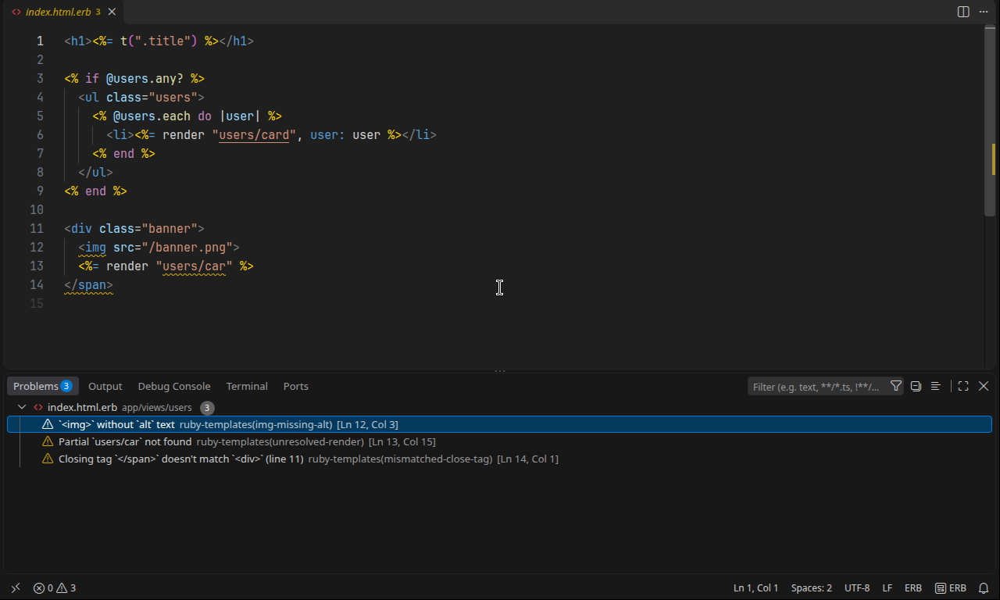
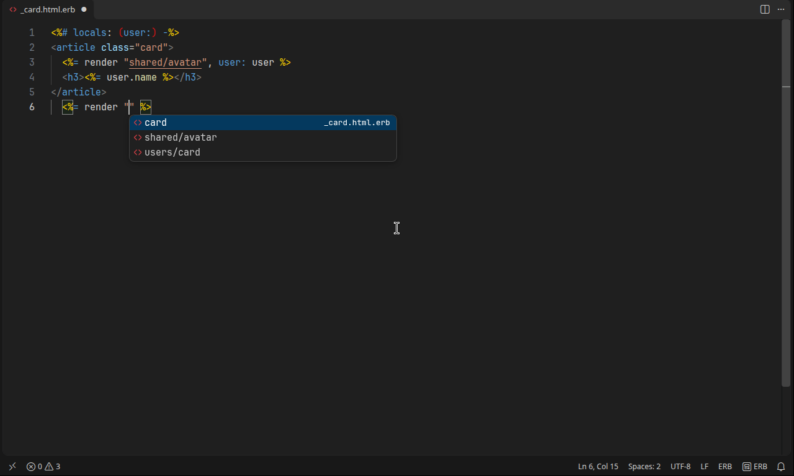
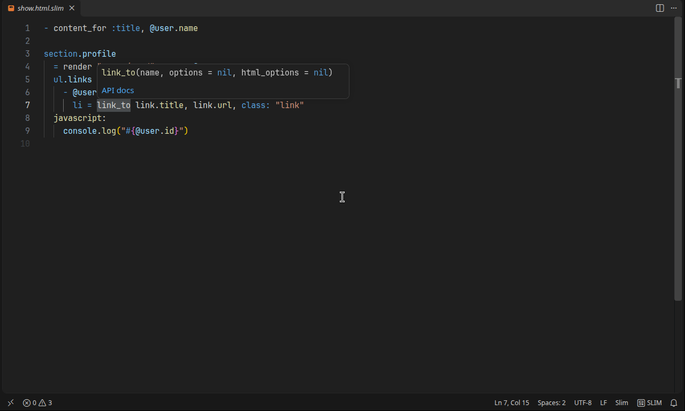
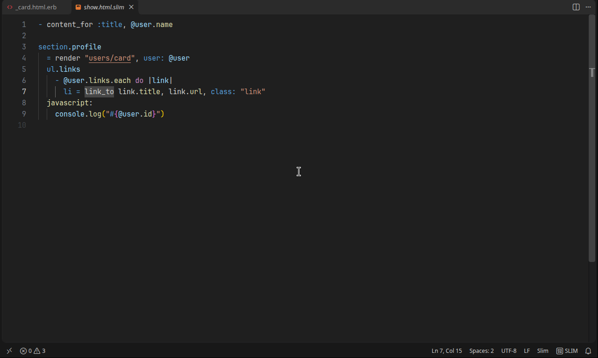

<p align="center"></p>

# Ruby Templates: ERB, Haml, Slim

[](https://github.com/x-ror/vscode-ruby-templates/actions/workflows/build.yml)
[](LICENSE)


One extension for the three most common Ruby HTML template languages.

## Screenshots

**Diagnostics as you type**: unclosed blocks, mismatched tags, missing `alt`, unresolved partials.



**Completion** of partial names inside `render "…"`.



**Hover** on a Rails helper shows its signature and links to the API docs.



**Highlighting** for Slim with embedded JavaScript and `#{}` interpolation, and the same for ERB and Haml.



## Features

**Syntax highlighting**

- ERB (also `.erubi` / `.erubis`): `<% %>`, `<%= %>`, `<%== %>`, `<%# %>`, `<%- -%>`, `<%%` literals, on top of the built-in HTML grammar.
- Haml: `!!!`, `%tag.class#id`, `{ruby: hash}` / `(html attrs)` / `[object ref]` attributes, `- = != &= ~` lines, `-#` and `/` comments, `#{}` interpolation, filters (`:javascript`, `:css`, `:ruby`, `:scss`, `:sass`, `:coffee`, `:markdown`, `:erb`, …).
- Slim: `doctype`, `tag.class#id`, inline `attr="x"` / `attr=ruby`, wrapped `()` `[]` `{}` attributes (also across lines) with boolean attrs, `*splat`, `li: a` inline tags, `a>` / `a<>` / `img/`, `|` / `'` text blocks and text continued under `p Some text`, `- = == =< =>` lines with `,` / `\` continuations, `/`, `/!` and `/[if IE]` comments, `#{}` and `#{{}}` interpolation, inline HTML `<div>` lines, `include` (`slim/include`), `>` text (`slim/smart`).
- Slim embedded engines (attributes such as `javascript nonce=...:` allowed): `javascript:`, `css:`, `ruby:`, `scss:`, `sass:`, `coffee:`, `markdown:` and `erb:` use the target grammar, with `#{}` highlighted as Ruby in `javascript:`, `css:` and `markdown:`; `textile:`, `rdoc:`, `asciidoc:` and older engines (`less:`, `styl:`, `builder:`, …) are plain text with `#{}`. Slim 5 registers only `asciidoc`, `markdown`, `textile`, `rdoc`, `coffee`, `sass`, `scss`, `javascript`, `css` and `ruby`, so `typescript:`, `babel:`, `livescript:` and `haml:` get no engine rule.
- Skim (`.skim`): the Slim grammar with CoffeeScript instead of Ruby in code lines, attributes and `#{}`.

**Editing**

- Bracket matching, auto-closing pairs (`<%` → `<% %>`), comment toggling (`Ctrl+/`), indentation rules for `if/each/do … end`, indentation-based folding for Haml/Slim.
- Snippets for Rails helpers: `link_to`, `render`, `form_with`, `ff` (form field), `each`, `if`, `turbo_frame`, `ts-append` (Turbo Stream actions), `locals` (strict locals), `stimulus`, `flash`, `errors`, `layout`, and more. Type the prefix and press Tab.

**Language server (Rust)**

A small language server written in Rust (`server/`, built on tower-lsp) adds what a TextMate grammar can't:

- Diagnostics as you type:
  - ERB views with an HTML host: `` / `image_tag` without `alt`, duplicate static ids, `">` (use `image_tag`, info), unescaped output `<%==` / `raw` / `.html_safe` (info).
  - ERB: Ruby syntax errors inside tags (`<%= foo( %>`, `<% x = 1 y = 2 %>`), a `<%` with no `%>` (a warning in HTML views: it is text, and the HTML parser rejects it; one left open before the next `<%` is a Ruby syntax error), `%>` inside a Ruby string (ERB ends the tag there), blocks without `<% end %>`, stray `end`, `if`/`end` inside `<%= %>`.
  - Haml / Slim: mixed tabs and spaces, inconsistent indentation, dedent to a level that doesn't exist, explicit `- end`, unclosed attribute brackets, unknown filters / embedded engines, nesting under a doctype, Haml illegal nesting (inline content + children).
  - Each check has a code (shown in the Problems panel); turn one off with `rubyTemplates.erb.disabledDiagnostics`, `rubyTemplates.haml.disabledDiagnostics`, `rubyTemplates.slim.disabledDiagnostics` or (Jbuilder/Builder) `rubyTemplates.jbuilder.disabledDiagnostics`, e.g. `"rubyTemplates.erb.disabledDiagnostics": ["unclosed-element"]`.
  - `rubyTemplates.<erb|haml|slim>.diagnostics.enabled` (default on) turns all of a language's diagnostics off; Skim follows `slim`. `rubyTemplates.<erb|haml|slim>.format.enabled` (default on) makes the built-in formatter return no edits for that language. The `ruby-templates` command line has no editor settings and ignores both.
- Code action _Add spaces inside this ERB tag_ (`<%=foo%>` → `<%= foo %>`), and the same for the whole file as `source.erbSpacing`, which `"editor.codeActionsOnSave": { "source.erbSpacing": "explicit" }` runs on save.
- Quick fix on an unresolved `render "dir/name"` warning: _Create partial `dir/_name.html.erb`_ (the view's format and template language), in every language.
- Go to definition (`F12` / Ctrl+click) on `render "users/card"`, `render partial: "row"`, `render template:`, `render layout:` and `render FooComponent.new` → opens the partial, template or component.
- Hover on a render call shows the resolved file(s); hover on a Rails helper shows its signature. In Slim, hover on a line marker (`-`, `=`, `==`, `=<`, `=>`, `/`, `/!`, `/[if IE]`, `|`, `'`, `javascript:` and other engines) explains it.
- Completion: HTML in ERB views (elements after `<`, the open element after `</`, attribute names in a start tag), partial names inside `render "…"`, ViewComponent classes after `render ` (inserted as `ButtonComponent.new(…)`), form builder methods after `f.`, model attributes after `f.text_field :` (columns from `db/schema.rb` for the model of the enclosing `form_with model:`), Turbo Stream actions after `turbo_stream.`, Stimulus controller names in `data-controller` / `data-action` values, controller methods after `hello#` and `static targets` names in `data-hello-target`, and Rails view helpers (`link_to`, `form_with`, `turbo_frame_tag`, `number_to_currency`, …) with snippet arguments. In Slim, helpers are offered only in Ruby (after `-`/`=`, in `attr=value`, `*splat`, `#{}`, `ruby:` bodies and continuation lines, not in text); HTML tag and embedded engine names (including `rubyTemplates.slim.extraEngines`) where a tag starts; common HTML attribute names where an attribute may start (`a hr`, `input(ty`).
- Haml: completion of filter names after `:`, tags after `%`, attribute names in `{}` / `()` (including `data:` / `aria:` keys) and `succeed` / `precede` / `surround` / `preserve`; hover on filters and on `=`, `&=`, `!=`, `~`, `==`, `&`, `!`, `<`, `>`; an outline (`content_for`, forms, Turbo Frames, `render`, `#id` and landmark tags) and folding for multi-line attribute hashes and `|` blocks.
- Jbuilder and Builder views (`*.json.jbuilder`, `*.xml.builder`) stay on the `ruby` language (so Ruby LSP keeps them) and get partial navigation, hover, links, completion and render warnings for `json.partial! "x"`, `json.array! @posts, partial: "posts/post", as: :post` and `xml << render(partial: "x")`.
- Typing the `>` of a start tag in ERB adds its end tag (`<div class="<%= x %>">` → `</div>`), skipping void and self-closing tags and `>` inside ERB code; `rubyTemplates.erb.autoCloseTags` turns it off.
- Linked editing in HTML-host ERB (`.html.erb`, …): renaming `<div>` renames its `</div>` too, with ERB tags in between. Turn it on with `"[erb]": { "editor.linkedEditing": true }`.
- Controllers: go to definition on `def show` opens the action's templates; `layout "admin"`, `render :edit`, `render "users/show"` and `render partial: "form"` link to their views. Ruby LSP keeps every other feature in controllers.
- Go to definition on a helper called in a view (`format_price(…)`) opens its `def` in `app/helpers`, or in a controller that exposes it with `helper_method`.
- Route helpers: completion of `*_path` / `*_url`, hover with the path and each verb's `controller#action`, and go to definition into `config/routes.rb` (Rails 7.1+ records where each route is defined). The routes come from `bin/rails runner`, which boots the app once when a view of it opens and again when `config/routes.rb` or `config/routes/*.rb` change. That runs the app's own code, so it happens only for an app inside a trusted workspace folder (not for a file opened on its own), and a failed boot is retried only after a routes file or setting changes. Turn it off with `rubyTemplates.routes.enabled`.
- Instance variables: after `@`, completion of the ones the view's controller action assigns, its `before_action` callbacks included (`only:` / `except:` respected, including those of parent controllers such as `Admin::BaseController` and `ApplicationController`; a partial gets every action of its folder's controller). Go to definition on `@user` lists the assignments.
- Locals: go to definition on a local in a partial lists the `render` calls that pass it (`user: …`), or its strict-locals comment.
- ViewComponent slots: inside `render CardComponent.new do |c|`, `c.` offers the `with_*` setters of its `renders_one` / `renders_many` slots (`with_item` and `with_items` for `renders_many :items`); the component's own template offers `header` and `header?`.
- _Go to Symbol in Workspace_ (`Ctrl+T`) finds partials and templates by the name `render` uses: `uscard` → `users/card` (partial). It searches the workspace folders open at startup, plus the `app/views` of any open view (a folder added later counts once one of its views is open).
- Find All References (`Shift+F12`) on a `render "…"`, or anywhere in a partial, lists the `render` calls that resolve to it in views, controllers, helpers and components (same search and limits as rename below). On a `t("…")` key it lists the calls with the same full key in any template or Ruby file of `app/` and `lib/` (lazy `.title` keys resolved per view) and the key in each locale file.
- Renaming or moving a partial in the Explorer updates the `render "…"` calls that point to it in ERB, Haml and Slim views. Renaming a folder under `app/views` re-qualifies the renders of the partials in it, and qualified `render partial: "dir/name"` calls in `app/controllers`, `app/helpers` and `app/components` are updated too. Limits: only the same `app` tree is searched (engines are not); a `render` is changed only when every variant Rails could pick for it (`_card.html.erb`, `_card.html+phone.erb`, …) moves to the same new name; moving a partial directly into `app/views` changes nothing; `render` text inside a Ruby string, comment or template text is left alone.
- Slim formatting (_Format Document_): re-indents each Slim line to the indentation width (the editor's tab size, or `indent_size` in `.editorconfig`; 2 by default) in spaces, moves text blocks, engine bodies and continuation lines with their line (keeping their relative indentation), and strips trailing whitespace except where it is part of the output (`|`/`'` text, inline text, quoted attribute values, engine bodies). A file Slim would reject (or that uses `slim/smart` `>` lines) is left unchanged. The formatter always writes spaces, even when the editor indents with tabs, and keeps each line's ending as it is. A byte order mark and whitespace-only lines at the end of the file are kept, since Slim compiles them, while empty lines after the last of them become the single final newline, since Slim drops them; no other editor, `.editorconfig` or `.slim-lint.yml` setting changes Slim formatting ([docs/FORMATTER_CONFIG.md](docs/FORMATTER_CONFIG.md)). Format on save: `"[slim]": { "editor.formatOnSave": true }`. The formatter is registered for Slim and Skim only, through dynamic registration, so ERB and Haml keep their own formatters (clients without dynamic registration get no formatter).
- The built-in formatter (ERB with `rubyTemplates.erb.formatter: builtin`, Haml, Slim, and the `ruby-templates format` command line) takes its settings from the editor, `.editorconfig`, then the whitespace linters of `.erb_lint.yml` / `.haml-lint.yml` (ERB, Slim and Haml take only the indentation width); see [Built-in formatter](#built-in-formatter).
- `ruby-templates-ls --check file.slim …` runs the same diagnostics from the command line (exit code 1 on errors), handy for CI. `ruby-templates-ls --format file.slim` prints the file formatted with 2 spaces (exit code 1 if it can't be formatted safely).

The binary for your platform is bundled in `bin/<platform>/`. To build it yourself: `bun run build:server` (needs a Rust toolchain and [Bun](https://bun.sh)). Settings: `rubyTemplates.server.enabled`, `rubyTemplates.server.path`. Command: _Ruby Templates: Restart Language Server_.

**Commands** (Command Palette, right-click menu, or keybinding)

| Command                           | Keys         | What it does                                                                                                                                                                                                                                                                                    |
| --------------------------------- | ------------ | ----------------------------------------------------------------------------------------------------------------------------------------------------------------------------------------------------------------------------------------------------------------------------------------------- |
| Toggle ERB Tag                    | `Ctrl+Alt+E` | Cycles the tag under the cursor: `<% %>` → `<%= %>` → `<%# %>`                                                                                                                                                                                                                                  |
| Wrap Selection in ERB Output Tag  | `Ctrl+Alt+W` | `foo` → `<%= foo %>`                                                                                                                                                                                                                                                                            |
| Toggle Slim Line                  | `Ctrl+Alt+E` | Cycles the marker of each selected line: `-` → `=` → `==` → `/`; lines inside engine, comment and text blocks are left alone                                                                                                                                                                    |
| Wrap Selection in Slim Output     | `Ctrl+Alt+W` | A whole plain line becomes `= foo`; part of a line, or a line starting with a marker, `#{foo}`                                                                                                                                                                                                  |
| Extract Selection to Slim Partial |              | Moves the selected lines (dedented) to `_name.<format>.slim` (the file's format, else `html`) and leaves `= render "name"`; `dir/name` goes under `app/views/dir/`                                                                                                                              |
| Switch to Related File            |              | Opens the view's other formats (`welcome.html.erb` ↔ `welcome.text.erb`, `show.json.jbuilder`), its controller or mailer at the action's `def`, or a ViewComponent's class ↔ template (also in its sidecar folder) ↔ preview (`{test,spec}/components/previews`); a list when there are several |
| Preview Rendered HTML             | `Ctrl+Alt+P` | Renders the current file with `slimrb` / `haml` / Erubi (through `ruby`, as Rails compiles ERB; stdlib ERB without the gem) in a side panel, refreshes on save                                                                                                                                  |
| Show Compiled Ruby Source         |              | Shows the Ruby code the engine generates (great for debugging Slim/Haml)                                                                                                                                                                                                                        |
| Toggle Haml Line Prefix           | `Ctrl+Alt+E` | Cycles the current line(s) in Haml: `- x` → `= x` → `-# x`                                                                                                                                                                                                                                      |
| Extract Selection to Partial      |              | Moves the selection into `_name.html.haml` (or `.erb`) next to the file, re-indented to column 0, and puts `render "dir/name"` in its place                                                                                                                                                     |
| Re-indent Haml                    |              | Re-indents the document or selection to the indentation width (2 by default), through the language server (also _Format Selection_, and _Format Document_ by default)                                                                                                                           |
| Convert ERB/HTML → Haml           |              | Runs `html2haml --erb` (ERB) or `html2haml --no-erb` (plain `.html`)                                                                                                                                                                                                                            |
| Convert Haml → ERB                |              | Runs the `haml_to_erb` library through `ruby`                                                                                                                                                                                                                                                   |
| Convert ERB/Haml → Slim           |              | Runs `erb2slim` / `haml2slim`                                                                                                                                                                                                                                                                   |
| Convert Slim → ERB                |              | Runs `slimrb --erb`. The output is Slim's compiled form (`<%= ::Temple::Utils.escape_html((x)) %>`), correct for plain ERB but escaped twice under Rails' auto-escaping, so review it before committing                                                                                         |

The preview and converters shell out to Ruby gems, which you install once:

```sh
gem install slim haml erubi    # rendering
gem install html2haml          # ERB/HTML → Haml
gem install haml_to_erb        # Haml → ERB
gem install html2slim haml2slim  # ERB → Slim, Haml → Slim
gem install haml_lint          # Haml lint diagnostics, haml-lint formatter
gem install htmlbeautifier     # or erb-formatter: ERB formatting
gem install erb_lint           # ERB lint diagnostics
```

**Lint rule catalogue**: [`docs/lint/`](docs/lint/README.md) lists every check of the built-in server, erb_lint, Herb, haml-lint and slim-lint per language, which of them overlap, and when Herb prefers `image_tag` / `link_to` / `form_with` over plain HTML.

**erb_lint**: set `rubyTemplates.erbLint.enabled` to show `erb_lint`'s offenses (your `.erb_lint.yml`) on open and save; the editor's unsaved text is what gets linted. `rubyTemplates.commands.erbLint` sets the executable.

**herb-lint**: set `rubyTemplates.herbLint.enabled` to show [Herb](https://herb-tools.dev/linter/rules/)'s offenses (your `.herb.yml`, with its severities) on open and save. herb-lint has no stdin mode, so it lints the saved file. It is an npm package (`npm install --save-dev @herb-tools/linter`); the project's `node_modules/.bin/herb-lint` is used before one on `PATH`, and `rubyTemplates.commands.herbLint` overrides both. erb_lint and herb-lint can run side by side; turn off the built-in checks they duplicate with `rubyTemplates.erb.disabledDiagnostics`.

**ERB formatting**: set `rubyTemplates.erb.formatter` to `builtin` for the built-in formatter (see [Built-in formatter](#built-in-formatter); also _Format Selection_), to `htmlbeautifier` (`gem install htmlbeautifier`; re-indents to the editor's tab size) or `erb-format` (`gem install erb-formatter`; re-flows to a line width) and _Format Document_ / format on save run it (`"[erb]": { "editor.formatOnSave": true }`). The default `none` leaves ERB formatting to other extensions.

**haml-lint**: when `haml-lint` is installed, Haml files are linted on open and save and its offenses show up as diagnostics (`rubyTemplates.hamlLint.enabled`, `rubyTemplates.commands.hamlLint`, `rubyTemplates.hamlLint.useBundler`). Set `rubyTemplates.haml.formatter` to `haml-lint` to make _Format Document_ run `haml-lint --auto-correct-only`; note that it applies your RuboCop config's safe corrections too, which can rewrite or drop Ruby code (for example a useless assignment).

Executable paths are configurable under `rubyTemplates.commands.*`. Set `rubyTemplates.preview.useBundler` to run them through `bundle exec` in projects with a Gemfile.

Note that a standalone render has no Rails helpers (`link_to`, `render`, …). The preview is most useful for layout fragments and plain-Ruby templates. Set `rubyTemplates.preview.useRails` to render through the app instead: when a `bin/rails` is found above the file, the preview runs `bin/rails runner` with `ApplicationController.render(inline: source, type: :slim)` (or `:erb` / `:haml`), so helpers and routes work. It boots the app on each refresh and gives up after 60 seconds; the render runs on a controller whose path is the template's directory under `app/views`, so a bare `render "card"` finds the partial next to the file, as in a request. Set `rubyTemplates.slim.compileForRails` to show the Slim compiled source as Rails compiles it (`slimrb --rails`: ActionView output buffer, no capture).

## Built-in formatter

One formatter for HTML ERB views (`.html.erb`, `.html+variant.erb`, `.turbo_stream.erb`, `.html.erubi`, `.html.erubis`, `.rhtml`, localized views without a format), Haml and Slim, in the language server and in the `ruby-templates` command line. It changes **only whitespace**: the leading indentation of lines, trailing whitespace, blank lines, the final newline and line endings. It never wraps or joins lines and never reorders attributes; Ruby inside ERB tags is never touched, not even the indentation of a multi-line tag's continuation lines.

- **ERB**: a line gets one indent unit per open HTML element and ERB block (`<% if %>` … `<% else %>` … `<% end %>`, `do … end`, `case`/`when`); end tags and `<% end %>` at the start of a line dedent it. Multi-line HTML tags move as one unit with their first line, keeping their relative indentation. A missing final newline is not added. `<script>`, `<style>`, `<pre>`, `<textarea>` and `<title>` bodies (and the line of their end tag), the lines of an HTML comment after the one holding `<!--` (conditional comments included), quoted attribute values across lines, and every line of a multi-line ERB tag after the one it opens on (its Ruby, `<%#` comments included) keep every byte; only the line the element or tag opens on is re-indented; an element made `white-space: pre` by CSS is re-indented like any other. `<li>`, `<p>` and the other optional-end elements indent only when they have an end tag. Where ERB branches leave different tags open (`<% if a %><div><% end %>` … `<% if a %></div><% end %>`), the tags the last branch left open stay open, and such a block's `<% end %>` lines up with what is still open; if an end tag then doesn't match, the rest of the file keeps its indentation.
- ERB with `builtin`, Haml and Slim formatting run in the language server: with `rubyTemplates.server.enabled` off, or before the server is up, _Format Document_ changes nothing (_Re-indent Haml_ says so).
- **Haml**: every level becomes the indentation width (the editor's tab size or `indent_size`, default 2) in spaces, even for a tab-indenting editor or file; filter and `-#` bodies (and `~` / `:preserve` content) move as a block with their head, keeping their content, and continuation lines (`|` multiline, Ruby after a `,`, attribute groups) move with their line. Trailing whitespace goes where Haml ignores it (not in filter bodies), each line keeps its ending, and empty lines at the end collapse into the final line ending, since Haml drops them; no other editor, `.editorconfig` or `.haml-lint.yml` setting changes Haml formatting. Before writing, the formatter compares what Haml compiles from the text before and after and leaves the file as it is if they differ. Also _Format Selection_ and _Re-indent Haml_.
- **Slim**: as described above.
- A file the formatter is in doubt about (broken ERB, mismatched tags, a `javascript_tag do` or `content_tag :pre do` block, a Slim file Slim would reject, a Haml file with any Haml error, indentation errors included) comes back unchanged, and the reason is logged. Files that aren't HTML ERB (`.js.erb`, `.json.erb`, `.text.erb`, …), Jbuilder views and generator templates (`*.tt`) are never formatted.
- Every change is checked before it is returned: the result must be stable when formatted again, keep every non-whitespace character, and add no diagnostic.

**Settings** come from the editor (in VS Code), `.editorconfig`, then the few erb_lint / haml-lint / slim-lint linters that check the same whitespace (ERB, Slim and Haml take only the indentation width), then defaults (2 spaces). The table is in [docs/FORMATTER_CONFIG.md](docs/FORMATTER_CONFIG.md); it reads those files only to agree with them, it is not those tools.

**Command line**: the server build includes a second binary, also published on npm as `@x-ror/ruby-templates` with prebuilt binaries for Linux x64/arm64, macOS x64/arm64 and Windows x64:

```sh
npm install --save-dev @x-ror/ruby-templates
npx ruby-templates check app/views                 # diagnostics; exit 1 on errors or warnings
npx ruby-templates format --check app/views        # list files that would change; exit 1 if any
npx ruby-templates format --write app/views        # rewrite them
npx ruby-templates format app/views/users/show.html.erb          # print one file formatted
npx ruby-templates format --stdin-filepath show.html.erb < x     # from stdin, for editors
npx ruby-templates format --verbose --check app/views            # also the settings, config files read and keys ignored
```

Exit codes: 0 ok, 1 diagnostics or files that would change, 2 usage or I/O errors, a formatter bug caught by its checks, or a file named to `check` that isn't a template (`format` passes such files through unchanged and says why). `ruby-templates-ls --check` takes folders too. Folders are walked for template files, skipping hidden folders and `node_modules`.

**Not supported**: reflowing long lines or attributes (use `erb-format`), indenting embedded JavaScript or CSS by their own syntax, Ruby code formatting (use RuboCop through erb_lint or haml-lint), re-indenting a Haml file that has errors, Slim files indented with tabs, and resuming indentation after ERB branches that leave different tags open.

## Tips

- Emmet works in `.html.erb` out of the box (the extension defaults `"emmet.includeLanguages": { "erb": "html" }`). VS Code's Emmet supports the `slim` id natively and expands to Slim syntax (`ul>li` → `ul` / `  li`); the extension maps `skim` to it too.
- Host-specific Slim files (`.text.slim`, `.xml.slim`, `.js.slim`, …) open as Slim; the void-element check (`img` with children) only runs for HTML hosts (`.html.slim`, `.html+variant.slim`, `.turbo_stream.slim` and bare `.slim`).
- Partials resolve by Rails' default formats; a format an app registers itself (`Mime::Type.register "text/html", :mobile`) is read as part of the name, so `_card.mobile.haml` is not found for `render "card"`. Renders into a gem's view folder (`devise/…`, `spree/…`) aren't flagged when the gem is in `Gemfile.lock`.
- Rails generator templates (`lib/templates/{erb,haml,slim}/**/*.tt`, `lib/generators/**/templates/**/*.{erb,haml,slim}.tt`) open in their template language; diagnostics, formatting and linters skip them because the generator's own ERB is mixed in.
- Ruby LSP (Shopify) and this extension both register the `erb` language id, so they work together.
- If you also have another Slim or Haml extension installed, VS Code picks one grammar; disable the other to avoid surprises.
- Slim options set per app are not reflected in highlighting: custom `:shortcut`s (`&text`, `@role`), custom `attr_list_delims` / `code_attr_delims`, smart text's implicit text lines (only explicit `>` lines are recognized; the checks report them as `Unknown line indicator`, as Slim's default parser does without `slim/smart`) and logic-less mode (`- section` / `= var` still show as Ruby). The translator plugin (`slim/translator`) changes nothing in the syntax, so it needs no support.

## Development

```sh
bun install           # also enables .githooks (pre-commit formats staged JS and Rust)
bun run build:server  # cargo build --release, copies the binary into bin/<platform>/
bun run test:tokens   # token scopes of test/sample.* vs. test/__snapshots__, with VS Code's HTML/Ruby/JS/CSS grammars (UPDATE=1 rewrites them)
bun run test:server   # cargo test + diagnostics check on the samples
bun run test:unit     # pure JS helpers (ERB tags, language configs, Haml toggle, haml-lint JSON)
bun run test:snippets # snippets: unique prefixes, valid bodies, no unescaped `$`
bun test/e2e.js       # LSP end-to-end test against a fake Rails tree (exits 1 on a mismatch)
bun test/cli.js       # the ruby-templates command line on a temp folder
bun test/npm.js       # the npm packages: assembled from the release build, packed, installed offline, run
bun run test:slim     # Slim editing helpers and onEnterRules
bun run test:vscode   # commands, formatter, linters and the server inside a real VS Code (downloads it into .vscode-test/; `xvfb-run -a` first on Linux without a display)
bun run test:format   # Slim/Haml formatters vs. the gems: test/format/*.{slim,haml} compile the same before and after (needs `ruby -rslim` / `ruby -rhaml`)
bun run build         # bundle the client into dist/extension.js (what VS Code loads)
bun run package       # bundle, then build the .vsix
```

Grammars live in `syntaxes/`, language configs in `language-configuration/`, snippets in `snippets/`, the VS Code client in `src/`, and the language server in `server/src/` (a library shared by `ruby-templates-ls` and the `ruby-templates` CLI: `lsp.rs`, `cli.rs`, `format.rs` with `erb_format.rs`, `haml_format.rs`, `slim_format.rs` and `config.rs` for the formatter, `erb.rs`, `haml_indent.rs` and `slim_indent.rs` for Haml/Slim structure, `slim_parser.rs` (a port of `Slim::Parser` used by Slim completion, hover and formatting), `partials.rs`, `ruby.rs`). CI (`.github/workflows/build.yml`) builds the server for Linux, macOS and Windows, packages one `.vsix` per platform, and assembles the npm packages (`npm/`, `npm/assemble.js`); tags publish them.
