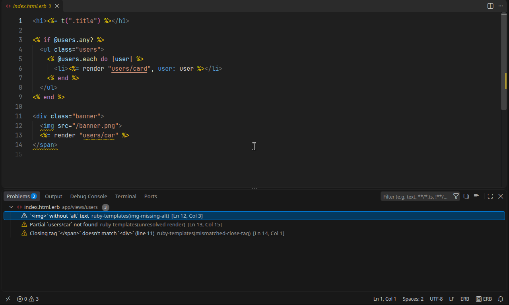
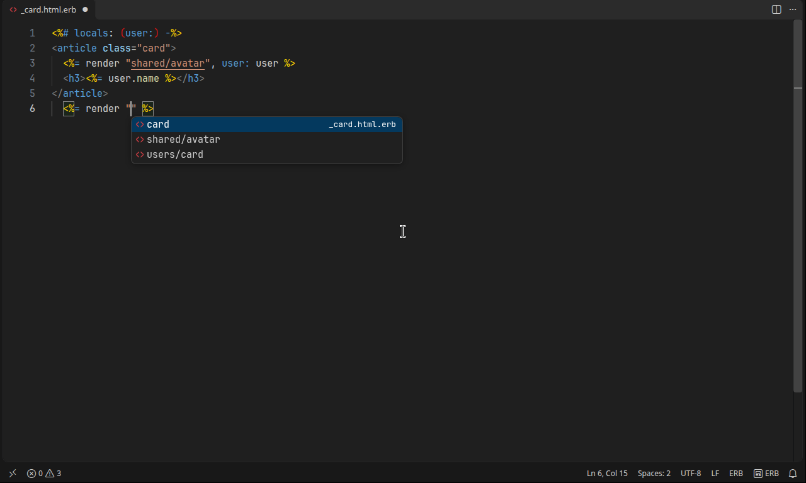
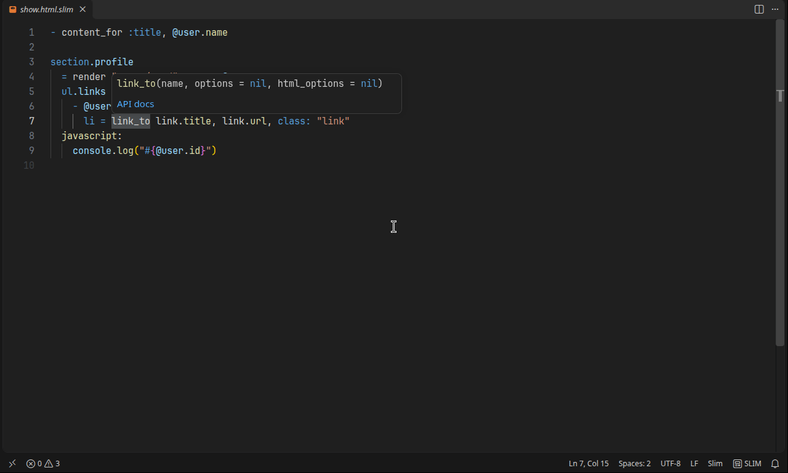
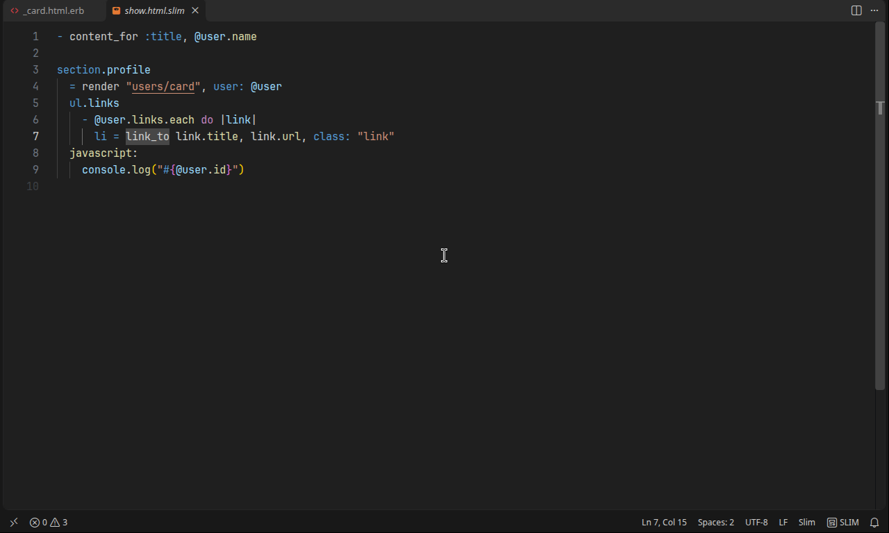

<p align="center"></p>

# Ruby Templates: ERB, Haml, Slim

[](https://marketplace.visualstudio.com/items?itemName=x-ror.ruby-templates)
[](https://open-vsx.org/extension/x-ror/ruby-templates)
[](https://www.npmjs.com/package/@x-ror/ruby-templates)
[](https://socket.dev/npm/package/@x-ror/ruby-templates)
[](https://github.com/x-ror/vscode-ruby-templates/actions/workflows/build.yml)
[](LICENSE)

**Rails view tooling for VS Code: one extension for ERB, Haml and Slim.** It highlights your templates, finds errors as you type, formats them, and understands your Rails app: partials, components, helpers, routes, instance variables, translations and Stimulus controllers.

Built for Rails developers who work in `app/views` every day, and for teams that want the same template checks and formatting in the editor and in CI.

- **No gems to install.** The checks and the formatter are a fast language server written in Rust and bundled with the extension. They follow Erubi, Rails, Haml 7 and Slim 5 and report errors with those projects' own messages.
- **Rails-aware.** <kbd>F12</kbd> on `render "users/card"` opens the partial; completion knows your partials, ViewComponents, model columns, `*_path` helpers, `@ivars` from the controller and `t(".keys")`.
- **Safe formatting.** It changes only whitespace and checks that the template still compiles to the same thing; if it is unsure, it leaves the file alone.
- **Works with Ruby LSP.** Install both: Ruby LSP keeps your `.rb` files, this extension adds what templates need.

## Screenshots

**Errors as you type**: unclosed blocks, mismatched tags, missing `alt`, unresolved partials.



**Completion** of partial names inside `render "…"`.



**Hover** on a Rails helper shows its signature and links to the API docs.



**Highlighting** for Slim with embedded JavaScript and `#{}` interpolation, and the same for ERB and Haml.



## Features

### Highlighting and editing

- Full syntax highlighting for ERB (`.html.erb`, `.erubi`, `.js.erb`, `.css.erb`, `.json.erb`, `.yml.erb`, …), Haml, Slim and Skim, including embedded JavaScript, CSS, SCSS, CoffeeScript and Markdown blocks.
- Comment toggling, bracket matching, auto-closing `<% %>`, smart indentation and folding.
- Typing `>` in ERB closes the HTML tag; renaming `<div>` renames its `</div>` (linked editing).
- 50+ snippets per language for Rails, Hotwire and ViewComponent: `link_to`, `render`, `form_with`, `ff`, `turbo_frame`, `ts-append`, `stimulus`, `locals`, `flash`, …
- Emmet in ERB and Slim.

### Errors as you type

- **ERB**: Ruby syntax errors inside tags (checked with Prism, Ruby's own parser, for your project's Ruby version), unclosed `<%`, blocks without `<% end %>`, mismatched or unclosed HTML elements, `` without `alt`, duplicate ids.
- **Haml and Slim**: the errors Haml and Slim themselves would raise (indentation, illegal nesting, unclosed attributes, unknown filters and engines, explicit `end`) at the same line and column, plus Ruby syntax errors in code lines, attribute hashes and `#{}`.
- **Rails**: `render` of a partial that doesn't exist (with a quick fix that creates it) and strict locals (`<%# locals: (user:) %>`) mismatches, with Rails' own messages.
- Every check has a code you can turn off; whole languages can be switched off too.

### Navigation and completion that know Rails

| Where                                 | What you get                                                                                                 |
| ------------------------------------- | ------------------------------------------------------------------------------------------------------------ |
| `render "users/card"`, `render @user` | Go to the partial, hover shows the file, completion of partial names, find all renders                       |
| `render ButtonComponent.new`          | Completion of ViewComponents, go to class and template, `with_*` slot completion                             |
| `@user`                               | Completion, hover and go to definition from the action and its `before_action`s                              |
| `users_path`, `edit_user_url`         | Completion, hover with the URL and `controller#action`, go to `config/routes.rb`                             |
| `t(".title")`                         | Completion, hover with each locale's value, go to the locale file, find references                           |
| `format_price(…)`                     | Go to the helper's `def` in `app/helpers` or `helper_method`, hover with its signature and comment           |
| `f.text_field :`                      | Form builder methods and model columns from `db/schema.rb`                                                   |
| `data-controller`, `data-action`      | Stimulus controller names, actions, targets, and the element's `-target`/`-value`/`-class` attributes        |
| `link_to`, `turbo_frame_tag`, …       | Rails helpers with snippet arguments and hover docs                                                          |
| `def show` in a controller            | Go to the action's templates                                                                                 |
| `user` in `@users.each do \|user\|`   | Go to the block parameter or the assignment that declares it                                                 |
| `user`, `item` (locals)               | Semantic colours for uses of strict locals (`parameter`) and block variables (`variable`) over the grammar's |
| `report.title`                        | Column type, `null:` and `default:` on hover, go to `db/schema.rb`                                           |

Plus: rename or move a partial in the Explorer and every `render` that points to it is updated; <kbd>F2</kbd> on a partial's strict local renames it in the partial and in every `render` that passes it; <kbd>Ctrl+T</kbd> finds templates by render name (`uscard` → `users/card`); outline and breadcrumbs for every template; Jbuilder and Builder views get partial navigation too.

### File types

The file name picks the language id, which decides the comment syntax and the `[erb-js]`-style editor settings; the server picks the checks by the same name.

| Files                                                                                                                                               | Language id                      | Comment toggle | Highlighting      | Extra checks     | Formatting |
| --------------------------------------------------------------------------------------------------------------------------------------------------- | -------------------------------- | -------------- | ----------------- | ---------------- | ---------- |
| `.html.erb`, `.html+phone.erb`, `.turbo_stream.erb`, `.rhtml`, `.html.erubi`, `.html.erubis`, bare `.erb` under `app/views` with a locale or markup | `erb` (also `.erubi`, `.erubis`) | `<%# %>`       | HTML + Ruby       | HTML tags, links | yes        |
| `.js.erb`                                                                                                                                           | `erb-js`                         | `//`, `/* */`  | JavaScript + Ruby | none             | no         |
| `.scss.erb`                                                                                                                                         | `erb-scss`                       | `//`, `/* */`  | SCSS + Ruby       | none             | no         |
| `.css.erb`                                                                                                                                          | `erb-css`                        | `/* */`        | CSS + Ruby        | none             | no         |
| `.json.erb`                                                                                                                                         | `erb-json`                       | `<%# %>`       | JSON + Ruby       | none             | no         |
| `.text.erb`, `.txt.erb`                                                                                                                             | `erb-text`                       | `<%# %>`       | Text + Ruby       | none             | no         |
| Any file you assign to `erb-percent` (see below)                                                                                                    | `erb-percent`                    | `<%# %>`       | Text + Ruby       | none             | no         |
| `.xml.erb`, `.rss.erb`, `.atom.erb`, `.svg.erb`                                                                                                     | `erb-xml`                        | `<!-- -->`     | XML + Ruby        | none             | no         |
| `.md.erb`                                                                                                                                           | `erb-markdown`                   | `<!-- -->`     | Markdown + Ruby   | none             | no         |
| `.rb.erb`                                                                                                                                           | `erb-ruby`                       | `#`            | Ruby              | none             | no         |
| `.yml.erb`, `.yaml.erb`                                                                                                                             | `erb-yaml`                       | `#`            | YAML + Ruby       | none             | no         |

Every row gets the ERB and Ruby checks and, under `app/views`, the `render` checks (`unresolved-render`, `strict-locals`). Only HTML hosts add the HTML ones (unclosed or unbalanced tags, missing `alt`, duplicate `id`), linked tag renaming and attribute completion. Any other bare `.erb` (`nginx.conf.erb`) gets the ERB and Ruby checks only.

`erb-percent` is for plain-Ruby ERB with `trim_mode: "%"` (RDoc-style templates, some gems): a line starting with `%` is Ruby and `%%` is a literal `%`. Rails' Erubi has no such lines (`% complete` in a view is text), so no file gets it by default; opt in with `"files.associations": { "lib/**/*.erb": "erb-percent" }`. It gets the ERB and Ruby checks with every `%` line compiled as Ruby, so `% if x` … `<% else %>` … `% end` is one block and a syntax error in a `%` line is reported on it. `%` lines get diagnostics and the preview (stdlib ERB, `trim_mode: "%-"`) only: no completion or definition inside them, no formatting, no HTML checks.

The comment column applies to a line that starts outside a tag. On lines strictly inside a multi-line `<% %>` or `<%= %>` tag (not its `<%` or `%>` line), <kbd>Ctrl+/</kbd> toggles a Ruby `# ` instead; on the `<%` line it comments as usual, and _Toggle ERB Tag_ comments a whole tag.

### Formatting

_Format Document_, _Format Selection_ and format on save for HTML ERB views, Haml and Slim. The formatter changes **only whitespace**: leading indentation, trailing whitespace, blank lines and the final newline. It never wraps or joins lines, never reorders attributes and never touches Ruby code.

- **ERB**: one indent per open HTML element and ERB block (`if`/`else`/`end`, `do … end`, `case`/`when`); multi-line tags move with their first line. `<script>`, `<style>`, `<pre>`, `<textarea>` and `<title>` bodies, quoted attribute values and the continuation lines of multi-line ERB tags keep every byte. Only HTML views are formatted, not `.js.erb`, `.json.erb`, `.text.erb`, Jbuilder or generator templates.
- **Haml** and **Slim**: every level becomes the indentation width in spaces; filter and engine bodies, text blocks and continuation lines move with their line. A file Haml or Slim would reject is left unchanged, and so is any result that wouldn't compile to the same output.
- **Safe by construction**: every result must be stable when formatted again, keep every non-whitespace character and add no diagnostic; otherwise the file comes back unchanged and the reason is logged.
- **Settings**: the indentation width comes from the editor's tab size, then `.editorconfig` (`indent_size`; `tab_width` for `indent_size = tab`), then 2. Indentation is always written in spaces and each line keeps its ending. `rubyTemplates.erb.format.alignComments` (`--align-comments` on the command line) moves the lines inside HTML and multi-line `<%#` comments with the comment's first line; by default they keep every byte.
- **Not supported**: reflowing long lines, indenting embedded JavaScript or CSS by their own syntax, Ruby formatting (use RuboCop), Haml files with errors and tab-indented Slim files.

### Commands

| Command                                  | Keys         | What it does                                                                         |
| ---------------------------------------- | ------------ | ------------------------------------------------------------------------------------ |
| Toggle ERB Tag / Haml Prefix / Slim Line | `Ctrl+Alt+E` | `<% %>` → `<%= %>` → `<%# %>`, and the same for `-` / `=` / comment in Haml and Slim |
| Wrap Selection in ERB / Slim Output      | `Ctrl+Alt+W` | `foo` → `<%= foo %>`, `= foo` or `#{foo}`                                            |
| Extract Selection to Partial             |              | Moves the selection into `_name.html.erb` (or Haml, Slim) and leaves a `render`      |
| Switch to Related File                   |              | View ↔ other formats ↔ controller action; ViewComponent class ↔ template ↔ preview   |
| Preview Rendered HTML                    | `Ctrl+Alt+P` | Renders the template in a side panel, optionally through your Rails app              |
| Show Compiled Ruby Source                |              | The Ruby the template engine generates, for debugging                                |
| Convert ERB ↔ Haml ↔ Slim                |              | Converts the current file between template languages                                 |

Preview and the converters call Ruby gems (`slim`, `haml`, `erubi`, `html2haml`, `haml_to_erb`, `html2slim`, `haml2slim`), installed only if you use them. Everything else works without Ruby.

### Command line for CI

The same checks and formatter run outside the editor, from npm:

```sh
npm install --save-dev @x-ror/ruby-templates
npx ruby-templates check app/views            # errors and warnings; exit 1 if any
npx ruby-templates format --check app/views   # files that would change; exit 1 if any
npx ruby-templates format --write app/views   # format them
npx ruby-templates format --stdin-filepath show.html.erb < show.html.erb   # from stdin, for editors
npx ruby-templates format --verbose --check app/views   # also the settings and .editorconfig files used
```

Exit codes: 0 ok, 1 diagnostics or files that would change, 2 usage or I/O errors. Folders are walked for template files, skipping hidden folders and `node_modules`.

## Getting started

1. Install **Ruby Templates** from the [VS Code Marketplace](https://marketplace.visualstudio.com/items?itemName=x-ror.ruby-templates) or [Open VSX](https://open-vsx.org/extension/x-ror/ruby-templates).
2. Open a Rails project and any view. That's it: highlighting, checks, navigation and formatting work immediately.
3. Optional: turn on format on save, e.g. `"[erb]": { "editor.formatOnSave": true }` (also `[haml]`, `[slim]`).

Several Rails apps in one window (multi-root workspaces, monorepos) work side by side: each file resolves partials, routes, translations and gems against the app it belongs to.

Requires VS Code 1.100 or newer, on Linux (x64, arm64), macOS (Apple silicon, Intel) or Windows (x64).

## Settings

| Setting                                                           | Default                    | Purpose                                                            |
| ----------------------------------------------------------------- | -------------------------- | ------------------------------------------------------------------ |
| `rubyTemplates.<erb\|haml\|slim>.diagnostics.enabled`             | `true`                     | Show a language's diagnostics                                      |
| `rubyTemplates.<erb\|haml\|slim\|jbuilder>.disabledDiagnostics`   | `[]`                       | Turn off single checks by code, e.g. `["unclosed-element"]`        |
| `rubyTemplates.<erb\|haml\|slim>.format.enabled`                  | `true`                     | Use the built-in formatter (off lets another extension format)     |
| `rubyTemplates.erb.format.alignComments`                          | `false`                    | Move lines inside ERB comments with the comment's first line       |
| `rubyTemplates.erb.autoCloseTags`                                 | `true`                     | Close HTML tags when typing `>`                                    |
| `rubyTemplates.routes.enabled`                                    | `true`                     | Read routes with `bin/rails runner` (trusted workspaces only)      |
| `rubyTemplates.slim.extraEngines`                                 | `[]`                       | Extra Slim embedded engines your app registers (e.g. `mjml`)       |
| `rubyTemplates.preview.useRails` / `useBundler` / `refreshOnSave` | `false` / `false` / `true` | Render the preview through the app, through `bundle exec`, on save |
| `rubyTemplates.commands.*`                                        |                            | Paths of the Ruby tools used by preview and converters             |
| `rubyTemplates.server.enabled` / `server.path`                    | `true` / bundled           | Run the language server, or use your own build                     |

## Supported syntax

What the grammars highlight and what the server parses (the server follows Erubi as Rails configures it, Haml 7.5 and Slim 5.2).

### ERB

| Syntax                   | Highlighting                          | Server                                    |
| ------------------------ | ------------------------------------- | ----------------------------------------- |
| `<% %>`                  | Ruby                                  | Code, no output                           |
| `<%- %>`                 | Ruby                                  | Same as `<%`                              |
| `<%= %>`                 | Ruby                                  | Escaped output                            |
| `<%== %>`                | Ruby                                  | Unescaped output                          |
| `<%# %>`                 | Comment                               | Comment                                   |
| `<%# locals: (user:) %>` | Strict locals, as Ruby                | Strict locals checks, renames, completion |
| `-%>`, `=%>`             | Tag end                               | Tag end (`=%>` as `-%>`, as in Erubi)     |
| `<%%`, `%%>`             | Literal `<%` / `%>`                   | Text, not a tag                           |
| `<%_`, `_%>`             | Not special: `_` starts the Ruby code | Not special, as in Erubi (code `_ x _`)   |
| `%` lines                | Only in `erb-percent`                 | Only in `erb-percent` (`trim_mode: "%"`)  |

Trim modes: Erubi's `trim: true`, the Rails default, is what the server models, so `-` before `%>` changes nothing in the checks. `trim_mode: "%"` is the opt-in `erb-percent` language id (see [File types](#file-types)); other stdlib modes (`<>`, `>`) are not modelled.

### Haml

| Syntax                                                                      | Highlighting      | Server                                                          |
| --------------------------------------------------------------------------- | ----------------- | --------------------------------------------------------------- |
| `%tag`, `.class`, `#id`, `!!!`, `/`, `-#`, `=`, `-`, `~`, `&=`, `!=`, `#{}` | yes               | Parsed as Haml 7.5.1 does, with its error messages              |
| Attributes `{…}`, `(…)`, `[…]`                                              | yes               | Parsed; Ruby inside is checked                                  |
| Filters `:plain` `:escaped` `:preserve` `:cdata`                            | Text              | Accepted                                                        |
| Filters `:javascript` `:css` `:sass` `:scss` `:less` `:markdown` `:erb`     | Embedded language | Accepted                                                        |
| Filters `:coffee` `:coffeescript`                                           | CoffeeScript      | Accepted                                                        |
| Filter `:ruby`                                                              | Ruby              | Accepted, body checked as Ruby                                  |
| Any other filter (Haml 5's `:maruku`, `:textile`, …)                        | Text              | `unknown-filter`                                                |
| `succeed`, `precede`, `surround`, `preserve`, `find_and_preserve`           | Ruby              | Completion and hover (Haml 6/7 `RailsHelpers`), Haml files only |

Haml 6 and 7 are targeted (Haml 7.5.1 is the reference); Haml 5 is not. Whether a filter's gem (`sass`, `coffee-script`, …) is installed isn't checked.

### Slim and Skim

| Syntax                                                                                                    | Highlighting                            | Server                                                              |
| --------------------------------------------------------------------------------------------------------- | --------------------------------------- | ------------------------------------------------------------------- |
| Tags, `.class`/`#id` shortcuts, `=`, `==`, `-`, `/`, `\|`, `'`, `doctype`, `#{}`                          | yes                                     | Parsed as Slim 5.2 does, with its error messages                    |
| Attribute wrappers `(…)`, `[…]`, `{…}`, or none                                                           | yes                                     | Parsed; Ruby inside is checked                                      |
| Engines `ruby:` `javascript:` `css:` `sass:` `scss:` `coffee:` `markdown:` `textile:` `rdoc:` `asciidoc:` | Embedded language where VS Code has one | Accepted                                                            |
| Other engines: `erb:`, `less:`, `stylus:`, …                                                              | Highlighted                             | `unknown-engine` unless listed in `rubyTemplates.slim.extraEngines` |
| Engines your app registers (`mjml:`)                                                                      | Text                                    | Accepted once added to `rubyTemplates.slim.extraEngines`            |

`.skim` files use the Slim syntax and the `slim` settings. Slim options set per app (custom shortcuts, attribute delimiters, smart text, logic-less mode) are not read.

## Compatibility

- **Ruby LSP** and this extension both register the `erb` language id and work side by side: Ruby LSP for `.rb` files, this extension for templates.
- **Other Haml or Slim extensions**: VS Code picks one grammar per language, so disable the other extension to avoid surprises (see [Troubleshooting](#troubleshooting)). To let another extension format, turn off `rubyTemplates.<lang>.format.enabled`.
- **Emmet** works in ERB out of the box (`"emmet.includeLanguages": { "erb": "html" }` is a default); VS Code's Emmet expands to Slim syntax in Slim and Skim.
- **Partials and formats**: a `dir/name` render missing from `app/views` is looked up in the app's engines, packs and components (`*/app/views`), then in the installed gems' views, for links, definition, hover and the missing-partial check; gem files are read-only (no diagnostics or rename edits); partials resolve by Rails' default formats plus the ones your app registers with `Mime::Type.register` in `config/initializers`; renders into a gem's views (`devise/…`) aren't flagged when the gem is in `Gemfile.lock`, and a folder that exists nowhere (`uesrs/card`) is flagged only once every view root, gems included, is known. Gems are found in `vendor/bundle`, `BUNDLE_PATH` (env, `.bundle/config`, `~/.bundle/config`) or `GEM_HOME`/`GEM_PATH`; with Ruby elsewhere (rbenv, asdf) the check stays off.
- **Generator templates** (`lib/templates/**/*.tt`, `lib/generators/**/templates/**`) open in their template language, without diagnostics or formatting, since the generator's own ERB is mixed in.
- **Slim options set per app** aren't reflected in highlighting: custom shortcuts and attribute delimiters, smart text's implicit text lines, logic-less mode.

## Troubleshooting

### Other extensions for the same languages

| Extension                                                                | Overlap                                                                    |
| ------------------------------------------------------------------------ | -------------------------------------------------------------------------- |
| Ruby LSP (`Shopify.ruby-lsp`)                                            | Registers `erb`; may add its own ERB diagnostics, completion or formatting |
| ERB formatters (e.g. `aliariff.vscode-erb-beautify`)                     | Formatter for `erb`                                                        |
| Other ERB grammars                                                       | Grammar for `erb`                                                          |
| Other Haml or Slim extensions (e.g. `karunamurti.haml`, `sianglim.slim`) | Grammar, snippets and often a formatter for `haml` / `slim`                |

Symptoms are doubled diagnostics or completions, a formatter that asks which one to use, or different colours than the screenshots.

- **Formatter**: choose ours per language with `"[erb]": { "editor.defaultFormatter": "x-ror.ruby-templates" }` (also `[haml]`, `[slim]`). To keep the other one, set `rubyTemplates.<erb|haml|slim>.format.enabled` to `false`.
- **Grammar**: VS Code uses one grammar per language id, so only one extension's grammar applies. Disable the other extension for the workspace, or move our files to another id with `"files.associations": { "*.html.erb": "erb" }`.
- **Diagnostics and completion**: turn off the duplicates in the other extension's settings. Ours: `rubyTemplates.<erb|haml|slim>.diagnostics.enabled` and `rubyTemplates.<erb|haml|slim|jbuilder>.disabledDiagnostics`.

### Check what is active

- **Language mode**: the language shown in the status bar (click it to change). This extension adds a `$(preview)` item with the template language (`ERB`, `HAML`, `SLIM`, `ERB-JS`, …) while a template is open; if it is missing, the file isn't one of ours.
- **Grammar**: _Developer: Inspect Editor Tokens and Scopes_ on a token. Scopes ending in `.erb`, `.haml` or `.slim` (`text.html.erb`, `text.haml`, `text.slim`) are ours.
- **Server**: the _Ruby Templates_ channel in the Output panel logs the language server, including why a format was skipped. _Ruby Templates: Restart Language Server_ restarts it. _Developer: Show Running Extensions_ lists every extension active for the window.

## Learn more

- [Changelog](CHANGELOG.md)
- [Contributing](CONTRIBUTING.md): building, testing, project layout.

Found a bug or missing a Rails feature? [Open an issue](https://github.com/x-ror/vscode-ruby-templates/issues).

## License

[MIT](LICENSE)
